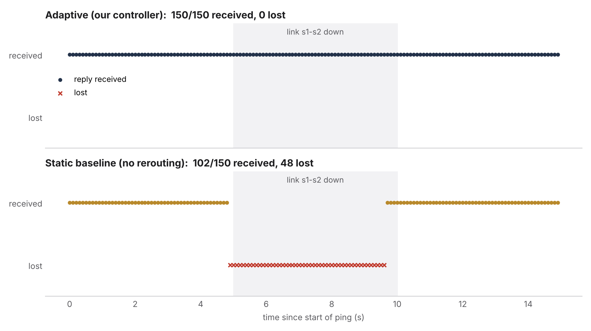

# Network layer: Mininet topology and SDN controller

This part builds the network and the SDN controller that keeps UDP traffic flowing when a link fails.

## Topology

```
         h1 (10.0.0.1)            h2 (10.0.0.2, server)
         h3 (10.0.0.3)                    |
            \                             |
             s1 ---- s2 (primary) ---- s4
               \                      /
                `--- s3 (backup) ----'
```

Switch ports are fixed in `topo.py`, so the controller always knows which port goes where.

| Switch | Port 1 | Port 2 | Port 3 | Port 4 |
|---|---|---|---|---|
| s1 | h1 | h3 | s2 | s3 |
| s2 | s1 | s4 | | |
| s3 | s1 | s4 | | |
| s4 | s2 | s3 | h2 | |

- Primary path: h1 to s1 to s2 to s4 to h2
- Backup path: h1 to s1 to s3 to s4 to h2

## How the controller works

1. When a switch connects, the controller installs IPv4 forwarding rules matched on destination IP. s2 and s3 always forward the same way. Only s1 and s4 decide which path is used.
2. **Link failure detection:** when a link goes down, the switches send an OpenFlow `PortStatus` message. If the port belongs to the primary path (s1 port 3, s2 port 1, s2 port 2 or s4 port 1), the controller rewrites the rules on s1 and s4 with `FlowMod` messages so traffic uses s3.
3. **Fail back:** when every primary port is up again, the rules on s1 and s4 are switched back to the primary path.
4. **Application alert (socket to SDN integration):** s1 and s4 have a rule that sends any UDP packet with destination port 9999 to the controller. When the UDP client sees repeated timeouts, it sends one such packet. The controller then moves traffic to the backup path, even if no port went down (for example, a link that is up but dropping packets).
5. **Static baseline:** start the controller with `STATIC=1` and it logs failures but never reroutes. We compare against this.
6. Every event is written to `controller_events.csv` with a timestamp, which gives detection and reroute times.

## How to run

Install (Ubuntu 22.04):
```
sudo apt install mininet openvswitch-switch python3-venv -y
python3 -m venv ~/ryuenv && source ~/ryuenv/bin/activate
pip install setuptools==67.6.1 && pip install ryu eventlet==0.30.2
```
If Ryu does not install, run `pip install os-ken` and start the controller with `python run_controller.py controller.py` instead of `ryu-manager controller.py`.

Terminal 1, the controller:
```
ryu-manager controller.py              # adaptive
STATIC=1 ryu-manager controller.py     # baseline
```

Terminal 2, the network:
```
sudo mn -c
sudo python3 topo.py           # interactive CLI
sudo python3 topo.py test      # automatic failover test
```

The automatic test pings h2 from h1 every 100 ms for 15 s. It cuts link s1–s2 at 5 s and restores it at 10 s, then prints the replies received, the lost sequence numbers and the approximate outage.

Manual check from the CLI:
```
pingall
sh ovs-ofctl -O OpenFlow13 dump-flows s1
link s1 s2 down
h1 ping -c 3 h2
sh ovs-ofctl -O OpenFlow13 dump-flows s1
link s1 s2 up
```

## Results

| Mode | Replies received | Lost | Approx outage | Controller reroute time |
|---|---|---|---|---|
| Adaptive | 150 / 150 | 0 | 0 ms | about 1 ms |
| Static baseline | 102 / 150 | 48 | 4800 ms | never rerouted |



With rerouting, the link cut causes no packet loss. With static routing, every packet sent while the link is down is lost until the link is restored.

Screenshots are in `results/`. Raw ping output and controller event logs for both runs are in `results/ping_*.txt` and `results/events_*.csv`.
